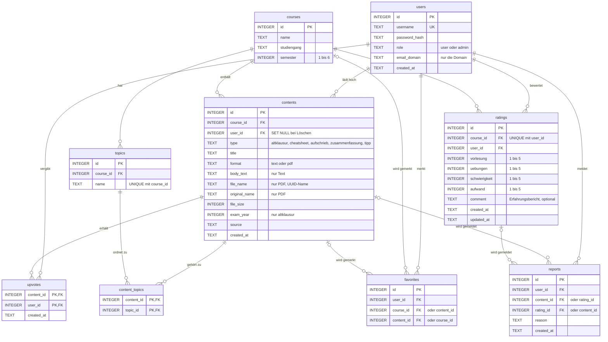

# ER-Diagramm

Das Diagramm entspricht `server/schema.sql`. GitHub zeigt den Mermaid-Block direkt als Grafik an.

## Beziehungen und Löschverhalten

| Beziehung | Art | Beim Löschen des Elternteils |
| --- | --- | --- |
| `courses` → `topics` | 1 : n | Themenfelder werden gelöscht (`CASCADE`) |
| `courses` → `contents` | 1 : n | Inhalte werden gelöscht (`CASCADE`) |
| `users` → `contents` | 1 : n | Inhalt bleibt, `user_id` wird `NULL` (`SET NULL`) |
| `contents` ↔ `topics` über `content_topics` | m : n | Zuordnung wird gelöscht (`CASCADE`) |
| `courses` → `ratings`, `users` → `ratings` | 1 : n | Bewertungen werden gelöscht (`CASCADE`) |
| `contents` → `upvotes`, `users` → `upvotes` | 1 : n | Daumen werden gelöscht (`CASCADE`) |
| `users` / `courses` / `contents` → `favorites` | 1 : n | Favoriten werden gelöscht (`CASCADE`) |
| `users` / `contents` / `ratings` → `reports` | 1 : n | Meldungen werden gelöscht (`CASCADE`) |

## Regeln, die das Schema selbst erzwingt

- `users.username` ist eindeutig, `users.role` ist `user` oder `admin`.
- `ratings`: Pro Kurs und Nutzer gibt es höchstens eine Bewertung (`UNIQUE (course_id, user_id)`). Alle vier Werte liegen zwischen 1 und 5.
- `upvotes`: Der zusammengesetzte Primärschlüssel `(content_id, user_id)` erlaubt pro Nutzer nur einen Daumen je Inhalt.
- `contents`: Der Typ `tipp` ist nur als Text erlaubt (`CHECK (type <> 'tipp' OR format = 'text')`).
- `favorites` und `reports`: Genau eine der beiden Spalten ist gesetzt (`CHECK ((a IS NULL) <> (b IS NULL))`). In `favorites` verhindert `UNIQUE` keine Duplikate, weil SQLite `NULL`-Werte als verschieden behandelt. Die Abfragefunktion prüft deshalb vorher selbst.
- Durchschnittswerte und Zählungen (Daumen, Anzahl Bewertungen) sind **nicht** gespeichert, sondern werden per SQL berechnet (`AVG`, `COUNT`). Damit gibt es keine Redundanz, und die 3. Normalform bleibt erhalten.
